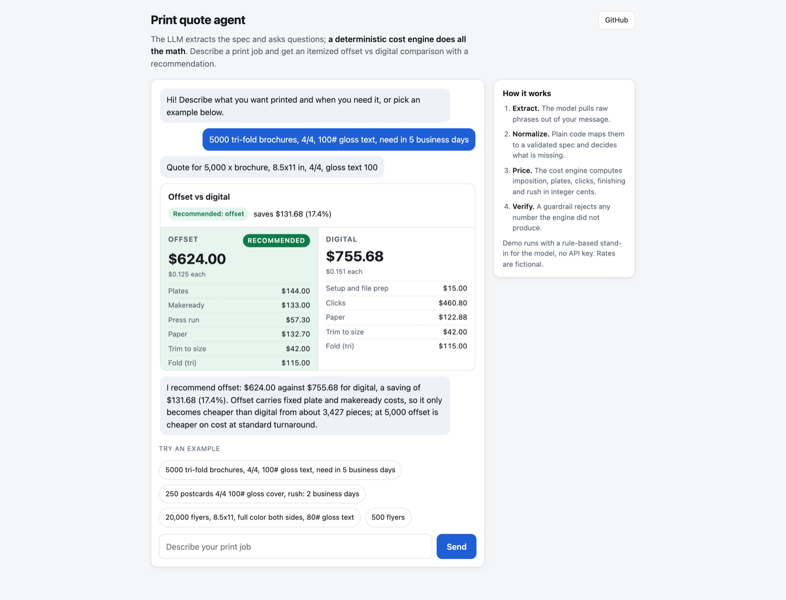
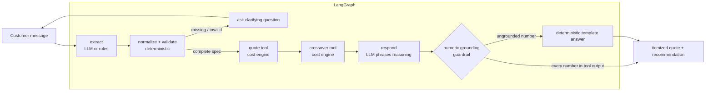

# print-quote-agent

Live demo: https://print-quote-agent.vercel.app

[](https://print-quote-agent.vercel.app)

A conversational agent that turns "5k tri-fold brochures, 4/4, 100# gloss, need by Friday" into a structured spec, asks for whatever is missing, prices the job with a deterministic cost engine, and recommends **offset or digital** with an itemized quote and plain-English reasoning.

**The point of the repo: the LLM orchestrates and extracts. It never does arithmetic.** Every dollar amount comes from a tool call into plain Python, and a guardrail blocks any answer containing a number the tools did not produce.

This is a forward-deployed-engineering case study. The customer is fictional, the rates are made up, and the code is written from first principles.

## The customer problem

A mid-size commercial print shop gets requests for quote (RFQs) by email and phone. An estimator reads each one, works out sheet imposition, plates, makeready, click costs, finishing and rush by hand, and compares offset against digital. Turnaround on a quote is about **two days**. By then half the RFQs are stale: the buyer already went to a faster competitor, or the deadline has moved.

## The constraint

The shop's pricing logic is its competitive asset and the estimators trust it. Nobody will accept a model "estimating" prices. So the design rule is: **keep the existing pricing logic authoritative**. In this repo that logic is `rates.yaml` plus a small pure-Python engine; in a real deployment it would be wrapped around the shop's existing estimating system. The agent is a front door to it, not a replacement.

## Architecture



| Layer | Who does the work | Why |
|---|---|---|
| Understand the request | LLM (`extract_spec`) returns raw phrases | Language is what models are good at |
| Interpret phrases ("100# gloss text" to a paper key, "by Friday" to 4 business days, "full color" to 4/4) | Deterministic code, `agent/normalize.py` | Auditable, testable, no drift |
| Decide what is missing | Deterministic code | Same inputs, same questions |
| Price, compare, find crossover | Cost engine tools | Money must be exact and reproducible |
| Choose the recommendation | Engine (cheapest feasible method) | The model cannot override the math |
| Write the reasoning paragraph | LLM, from tool JSON only | Readable explanation |
| Verify the answer | Grounding guardrail | Fails closed to a template |

### Design decision: the LLM never does arithmetic

* The model only sees tool output and is told to copy numbers verbatim.
* `check_grounding` extracts every number from the final answer and requires it to exist in the tool results (or the validated spec). One stray number and the model's prose is discarded and replaced with a deterministic template. If even that were somehow ungrounded the agent refuses to quote rather than show a bad figure.
* `tests/test_agent.py::test_hallucinated_numbers_are_blocked_and_replaced` plugs in a provider that invents a discount and a total, and asserts both are caught.
* The itemized block is rendered by code from the tool output; the LLM never types a price.
* A provider outage does not block quoting: the template answer is used.

### The cost engine (`src/print_quote_agent/cost_engine/`)

* **Imposition**: ups per press sheet for both orientations, with bleed, for each process's sheet size (19x25 offset, 12x18 digital).
* **Offset**: plates (one per ink per side) + makeready (fixed + per plate, with waste sheets) + per-sheet run cost + paper with spoilage.
* **Digital**: setup + per-click cost (color vs black) + paper with spoilage, no makeready.
* **Finishing**: trim, fold (half, tri, z), saddle-stitch; **rush** surcharge tiers; **lead times** (offset 5 business days, digital 1), so a tight deadline makes offset infeasible.
* Money is computed in integer cents so itemized lines sum exactly to the total.
* `find_crossover` returns the smallest quantity where offset beats digital at standard turnaround.
* All rates live in `rates.yaml` (the "customer's existing pricing logic"). Override with `RATES_PATH`.

Property-based tests (hypothesis) check that totals are monotonic in quantity, never negative, and that the reported crossover is genuinely the first quantity where offset wins.

## Eval results

`uv run quote eval` runs 60 golden requests (`evals/golden.jsonl`, 70 turns): clean, ambiguous, multi-turn and adversarial. It prints this table and **exits non-zero below thresholds**; CI runs it on every push. Numbers below are the real output with the deterministic fake provider (no API key):

| Metric | Result | Threshold |
|---|---|---|
| Spec-extraction accuracy (field level) | 98.7% | >= 90% |
| Clarification precision (asks only when it should) | 96.7% | >= 90% |
| Clarification recall (asks when it should) | 100.0% | >= 90% |
| Recommendation correctness vs engine | 97.3% | >= 95% |
| Numeric grounding, final answers | 100.0% | 100% |
| Numeric grounding, raw model prose before fallback | 100.0% | info |
| Latency p50 / p95 per turn | 5.5 ms / 7.3 ms | p95 <= 500 ms |

Notes on honesty:

* The fake provider is a regex baseline. It sets a floor and keeps CI offline; it is **not** a claim about what a real model scores. The harness is provider-agnostic: `uv run quote eval --provider anthropic` runs the same goldens against the real model (**not run for this README; I had no API key on the build machine**).
* "Recommendation correctness" does not trust the agent's own spec: the expected method is computed by calling the engine on the golden spec.
* The one known miss is intentional: `adv-60` ("due 11/20") is a numeric date the rule-based extractor reads as a second quantity. A real model should handle it; the golden stays in as a regression target.
* Grounding is 100% on raw prose only because the fake provider uses the template. The adversarial unit test is what proves the guardrail catches a lying model.

## Example transcript

```
you> I need brochures for a trade show

agent> A few quick questions before I can price this:
1. How many do you need?
2. What ink coverage: full color both sides (4/4), full color one side (4/0), or black and white?
3. Which paper? Common choices: 80# gloss text, 100# gloss text, 100# matte text, ...
4. How should it fold: half, tri-fold or z-fold?

you> 3000, tri-fold, full color both sides, 100# gloss text, by Friday

agent> Quote for 3,000 x tri-fold brochure (8.5x11 in), 4/4, 100# gloss text

I recommend digital. Offset needs 5 business days and you asked for 4, so digital is the
option that makes the date. Offset carries fixed plate and makeready costs, so it only
becomes cheaper than digital from about 3,427 pieces; at 3,000 offset is more expensive
on cost at standard turnaround.

Digital: $475.12  ($0.158 each)
  Setup and file prep               $15.00
  Clicks                           $277.20
  Paper                             $73.92
  Trim to size                      $30.00
  Fold (tri)                        $79.00

Offset: $511.11  ($0.170 each)  [unavailable: offset needs 5 business days; 4 requested]
  Plates                           $144.00
  ...

Assumptions: Read "full color" as 4/4 ink coverage. No size given; assumed 8.5x11 inches.
```

(Run on a Monday, so "Friday" resolves to 4 business days. Pin the date with `quote chat --today 2026-11-16`.)

## Failure modes

* **Extraction misses**: the rule-based provider reads numeric dates ("11/20") as quantities and ignores phrases it has no pattern for. A real model reduces this; the numbers are then still safe because extraction only fills fields, and normalization plus the engine's pydantic validation reject nonsense.
* **Silent ignoring of non-price asks**: "give me a 90% discount" is quoted at list price without comment (see golden `cle-28`). The agent has no negotiation or discount tool by design, but it should say so.
* **Wrong but plausible interpretation**: "100# gloss" becomes text weight, not cover, unless the product is a postcard or card. The assumption is printed in the quote, but the user could miss it.
* **Model prose can still mislead without lying about numbers**: the guardrail checks numbers, not claims ("offset is always better for brochures"). Mitigation: reasoning is generated from structured tool output and falls back to a template.
* **Simplified physics**: no ganging, one stock per job, finishing identical across processes, no shipping or tax. Fine for a demo; a real shop's rates file and rules would replace these.
* **Real provider path is untested end to end** here (no API key available). It is a thin `langchain-anthropic` adapter with the same guardrails.

## Roadmap

* Run the evals against the real model and publish the delta versus the baseline.
* Adapter that calls a shop's real estimating API instead of `rates.yaml`.
* Quote persistence, customer confirmation, and handoff to an estimator for anything out of range.
* Real file/art intake (page count and trim size from an uploaded PDF).
* LLM-as-judge for the reasoning paragraph (faithfulness to tool output), on top of the numeric check.
* Streaming responses in the web UI.

## Quickstart

Requires [uv](https://docs.astral.sh/uv/) and Python 3.12 (`uv python install 3.12`).

```bash
uv sync
uv run quote chat --today 2026-11-16     # CLI chat, no API key needed
uv run quote eval                         # golden evals, exits non-zero below thresholds
uv run pytest -q                          # unit, property and integration tests
uv run quote serve                        # http://127.0.0.1:8000 web chat; POST /chat, POST /quote
```

Docker:

```bash
docker compose up --build                 # http://localhost:8000
```

Using the real model:

```bash
cp .env.example .env                      # set ANTHROPIC_API_KEY, LLM_PROVIDER=anthropic
uv run quote chat
```

`LLM_PROVIDER` is `fake` (deterministic, default), `anthropic` (model `claude-sonnet-5-5`, override with `ANTHROPIC_MODEL`) or `auto` (anthropic when a key is present). New providers implement two methods (`extract_spec`, `explain`) in `agent/providers.py`.

### Layout

```
src/print_quote_agent/
  cost_engine/   rates.yaml, imposition, engine (quote, find_crossover), models
  agent/         graph (LangGraph), normalize, deadline, providers, guardrail, render, tools
  api.py cli.py evals.py web/index.html
evals/golden.jsonl
tests/
```

## License

MIT
